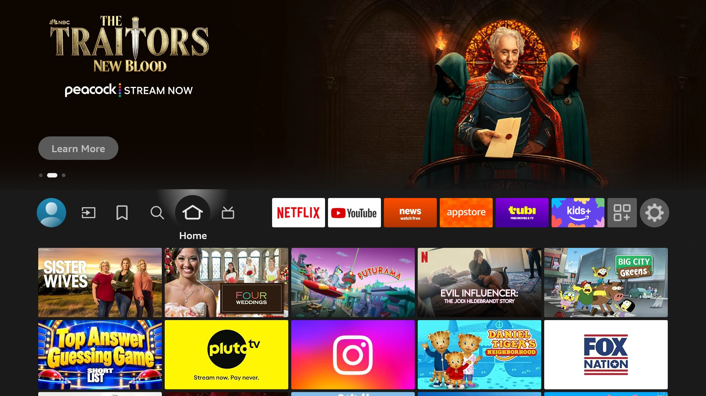
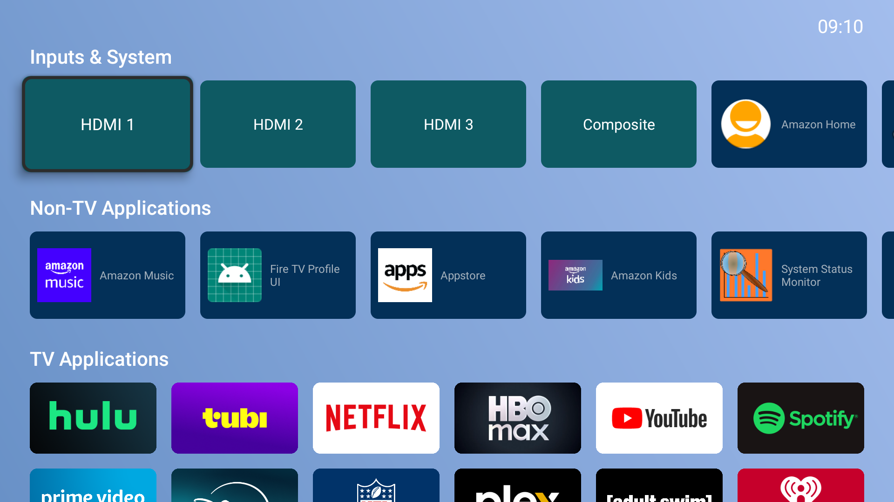

# Homestead

A replacement home screen for Fire TV: no advertising rows, no auto-playing trailers, no
sponsored placements. Your inputs and your apps, and nothing else.

It also replaces the Home **button**, which is the hard part — Fire OS pins Amazon's
launcher as the system home activity and will not let anything else take it.

| Before: Amazon's home screen | After: Homestead |
|---|---|
|  |  |

Both pictures are from the same TV, a few minutes apart.

## What it does

- **A home screen without the ads.** Your inputs, your TV apps and everything else, in
  three rows. No sponsored rows, no auto-playing trailers, no promoted tiles.
- **The Home button comes here.** Pressing Home opens Homestead in about 170 ms instead of
  Amazon's home screen.
- **HDMI and Composite inputs as tiles**, so switching source is one press from home.
- **Apps in the order you use them**, counted on the TV itself.
- **Hide anything** you do not want to see: press MENU on a tile, or hold Select.
- **TV Health** shows the state of the TV (animation speed, ad-tracking settings, the
  screensaver, which Amazon telemetry packages are running, free memory and storage). Each
  setting it flags can be fixed with one press.
- **Debloat** switches off up to 40 vetted Amazon packages, each with a plain-English
  description of what it does. Nothing is uninstalled and no data is deleted, and any
  package can be switched back on from the same page. A few packages are protected by
  Fire OS and cannot be switched off by any app.
- **No computer needed.** The on-device tunnel lets the app switch on the Home button,
  grant itself the permissions it needs and run Debloat, all from the remote. It is off
  until you turn it on and shuts down when the work is done. A few commands from a
  computer do the same job if you would rather not use it.
- **Updates itself.** It checks this repository's releases once a day and installs a new
  version only when you press Install, and only if it is signed with the same key.

## Verified on

Real hardware, not emulators:

| Device | Model | Fire OS | Verified |
|---|---|---|---|
| Insignia F30-Series Fire TV Edition | `AFTDCT31` | 7.7.1.5 | **Everything**: launcher, Home button, HDMI/Composite tiles, Settings, TV Health, Debloat, and setup without a computer |
| Amazon Fire TV Stick | `AFTSSS` | 7.7.1.6 | **Setup without a computer**: key approval, permissions, automatic shutdown of the tunnel |

Both run Android 9. Other Fire OS 7 devices are *expected* to work but are unverified.
**Fire OS 8 is untested.**

Debloat's list of packages was checked by hand on the Insignia TV above. Other models
and Fire OS versions may use different package names. Anything on the list that your TV
does not have is shown as "not present" and skipped, and packages the list does not know
about are only reachable through **Browse every system app**, which locks anything the
system is using but cannot tell you what is safe to switch off. If
your TV's packages differ, please open an issue with your model and the output of
`adb shell pm list packages -s` (system packages only, so it does not list the apps you
installed).

## Install

Download `homestead.apk` from the [latest release](https://github.com/Sarg338/Homestead/releases/latest)
and sideload it: `adb install homestead.apk` from a computer, or the Downloader app on the
TV. The app checks that release page once a day and offers new
versions under Settings → **Update**; it never installs one without you pressing Install.

## Setup

Fire OS does not list Homestead under Settings → Accessibility, so the Home button has to
be switched on over ADB, the TV's debugging connection. You can do that from the TV itself
or from a computer. Without it Homestead still works as an app you open from Amazon's app
row; only the Home button needs it.

The accessibility service is how the app learns that Home was pressed. It sees only which
app came to the front: it cannot read what is on screen and does not receive key presses.

### From the TV, no computer

1. Turn on **ADB debugging** under Settings → My Fire TV → Developer options. If Developer
   options is not there, open My Fire TV → About and press Select on the device name seven
   times.
2. Open **Homestead** from Amazon's app row. The first-run setup walks you through the
   rest. Later, the same steps are under the **Settings** tile → **Setup**.
3. Select **Set it up** (or **On-device tunnel (advanced)** in Setup) and accept Android's
   VPN prompt. In both prompts, press Down to reach OK.
4. The TV asks whether to allow the app's ADB key. Check that the fingerprint matches the
   one Homestead shows, tick **Always allow from this computer**, then select OK. Without
   the tick, the TV asks again every time the app connects.
5. The first-run setup then switches the Home button on by itself. In Setup, select
   **Finish setup automatically**, which also grants the permissions TV Health and Debloat
   need.
6. Press Home.

The tunnel runs only while the app is making changes and shuts itself off afterwards.
Some Amazon packages switch themselves back on after a restart; with **Re-apply after
reboot** on (the default), Homestead switches them off again about a minute after the TV
starts, which needs ADB debugging left on.

If the Home button ever goes back to Amazon's home screen, for example after an update,
select **Finish setup automatically** again.

### From a computer

```sh
adb connect <your TV's address>          # shown on the Commands page in the app
adb shell settings put secure enabled_accessibility_services com.homestead.launcher/com.homestead.launcher.HomeRedirectService
adb shell settings put secure accessibility_enabled 1
adb shell pm grant com.homestead.launcher android.permission.WRITE_SECURE_SETTINGS
```

The first two commands switch the Home button on; the first replaces any other
accessibility service you have switched on. The grant lets TV Health change settings from
the remote. To switch packages off, open **Commands for a computer** in the app: it lists
exactly the commands still needed on your TV.

## Removing Homestead

1. Open **Debloat** and select **Undo everything this app switched off**. This switches
   back on exactly the packages Homestead turned off. Uninstalling the app does *not* do
   this for you.
2. If you used the on-device tunnel, select **Forget our key** in Setup, then revoke the
   TV's copy under Settings → My Fire TV → Developer options, and turn ADB debugging off.
3. Uninstall Homestead under Settings → Applications → Manage Installed Applications.

Uninstalling also removes the accessibility service, so the Home button goes back to
Amazon's home screen straight away. To visit Amazon's home screen without turning anything
off, use the **Amazon Home** tile.

## How the Home button works

Fire OS does not let any app replace Amazon's launcher as the system home screen, so
Homestead uses an accessibility service to notice when Amazon's launcher comes to the
front, and covers it straight away.

Fire OS holds back app launches for several seconds after a Home press, so Homestead shows
its home screen as an overlay window, which is not held back. Its normal screen takes over
once Fire OS allows it, keeping the selected tile and scroll position.

The overlay is an accessibility overlay, which needs no extra permission.

## Known limitations

- **Amazon's home screen shows for a moment** on each Home press, before Homestead covers
  it. Fire OS reports the press only once Amazon's screen has started to appear.
- **Home does nothing while Amazon's home screen is already showing**, because Fire OS
  reports nothing in that case. Open any app, then press Home.
- **The Amazon Home tile pauses Homestead for 30 seconds.** After that, Homestead may take
  over again while you are still browsing Amazon's home screen.

## How the on-device tunnel works

Changing system settings and switching packages off needs the same `shell` access a
computer gets over ADB. Homestead includes its own ADB client, so it can do this on the TV
itself. Fire OS refuses an ADB connection that starts on the TV, so the app makes the
connection through a small on-device VPN tunnel that carries only traffic for the TV's own
ADB service.

The tunnel is opt-in (Setup → **On-device tunnel (advanced)**) and off by default. Once on,
it starts only when the app has changes to make, including after a restart when **Re-apply
after reboot** is on, and shuts down shortly afterwards. The TV itself asks you to approve
the app's ADB key. See [SECURITY.md](SECURITY.md) for what this does and does not
expose.

## Building

No Gradle, no dependencies, about two seconds:

```sh
./build.sh            # build + sign
./build.sh install    # and adb install -r
```

Needs the Android SDK (`build-tools/36.1.0`, `platforms/android-34`) and a JDK. The signing
key is **not** in this repository; `build.sh` looks for `~/.homestead-keys/` or the
`HOMESTEAD_KEYSTORE` / `HOMESTEAD_KEYPASS` environment variables (to make your own key,
see [Building and signing your own copy](#building-and-signing-your-own-copy)). Set
`ADB_TARGET` to your TV's `ip:port` for `./build.sh install`.

The ADB client is written from the AOSP sources (`system/core/adb`,
`libcrypto_utils/android_pubkey.c`); no code is copied.

## AI assistants

Notes for coding agents, and for anyone else picking this repository up cold.

### Where things are

There is no Gradle; everything is in `src/com/homestead/launcher/`. Each class starts with a
comment explaining why it exists. Read it before changing the class.

| Area | Classes |
|---|---|
| Home screen | `MainActivity`, `HomeGrid` (the UI, shared by the activity and the overlay), `AppModel` (tiles, artwork, order), `UsageTracker`, `HdmiActivity`, `BootReceiver` |
| Home button | `HomeRedirectService` (accessibility service and overlay; its timings are deliberate) |
| Pages | `Panel` (the list page), `OnboardingPanel` (first-run setup), `SetupPanel`, `SettingsPanel`, `HealthPanel` (TV Health), `DebloatPanel`, `CommandsPanel`, `UpdatePanel` |
| ADB | `AdbBridge` (one worker thread, link state, command batches), `AdbConnection` (the client), `AdbCrypto` (the key), `TunnelVpnService` and `VpnSetupActivity` (the on-device tunnel) |
| Debloat list | `Debloat` (the package catalogue, the never-touch lists, live locks) |
| Updates | `UpdateChecker` (the GitHub repo is `UpdateChecker.REPO`), `UpdateInstaller`, `UpdateFileProvider` |
| Preferences | `Prefs` |

### Building and signing your own copy

`./build.sh` needs a JDK (11 or newer), Android build-tools 36.1.0 and platform android-34.
It has been run on Windows (Git Bash) only; it picks the right tool names for Linux and
macOS, but those are untested. `minSdk` is 22 and `targetSdk` is 28. Do not raise
`targetSdk`: newer levels tighten the background-start rules the Home button relies on.

The release signing key is not in the repository. To build your own, make a key once:

```sh
mkdir -p ~/.homestead-keys
keytool -genkeypair -keystore ~/.homestead-keys/homestead-release.keystore \
  -alias homestead -keyalg RSA -keysize 2048 -validity 10000
export HOMESTEAD_KEYPASS='<the password you chose>'
./build.sh
```

A build signed with your own key cannot install over an official one (or the other way
round), so uninstall first. Uninstalling loses Homestead's record of what it switched off,
so run **Undo everything this app switched off** in Debloat before you do.

### Debugging on a TV

Test on real Fire TV hardware. The behaviour this app works around (Amazon's pinned home
screen, the delay on app starts after Home, protected packages, the missing Accessibility
entry) does not exist on an emulator or stock Android.

```sh
adb connect <tv-ip>:5555
adb logcat -s Homestead                                        # every log line uses this tag
adb shell settings get secure enabled_accessibility_services   # is the Home button switched on?
adb shell dumpsys accessibility                                # ...and running? look for label=Homestead
adb shell dumpsys activity activities | grep mResumedActivity  # what is on screen
adb shell pm list packages -d                                  # what is switched off
adb exec-out screencap -p > screen.png
```

Log lines worth knowing: `HomeRedirectService connected` (the service started),
`dispatchLag=…` then `overlay shown in … ms` (one Home press), `handing off to activity`,
`foreground is now …, removing overlay`, `tunnel up`, `adb connected`, `adb idle, closing`.

Things that look like bugs but are Fire OS:

- Fire OS's Accessibility menu does not list third-party services. The service has to be
  switched on over ADB.
- Pressing Home while Amazon's home screen is already showing produces no event Homestead
  can see. The system's Home broadcast is restricted to Amazon-signed apps.
- Fire OS refuses an ADB connection that starts on the TV itself; that is why the tunnel
  exists. The connection over Wi-Fi from a computer also drops often, so reconnect before
  each command when scripting.
- `pm disable-user` on some Amazon packages fails with "Cannot disable a protected
  package". Batches carry on past it, and TV Health counts those as protected.
- In the system VPN and USB-debugging prompts, no button has focus at first. Press Down to
  reach OK.
- `uiautomator dump` cannot read Homestead's windows. Use screenshots.

Homestead pauses the Home redirect while the user is on a setup screen (settings, VPN
prompt, key prompt), and lifts the pause when they come back. If Home "does nothing" during
testing, check whether a pause is active before suspecting the service.

### Rules for changes

- **Debloat list:** add a package only after switching it off, restarting the TV and
  switching it back on, on a real device, with nothing broken. Say which device in the
  pull request. `SAFE` entries are included in the one-press switch-off; anything with a
  visible side effect is `CAUTION`. Never add anything on the never-touch lists.
- Everything the app changes must be reversible from the app.
- Keep the accessibility service as narrow as it is (`canRetrieveWindowContent="false"`,
  no key filtering, no package filter). SECURITY.md promises this.
- Describe only what you have tested. "Should work on X" belongs in a pull request
  description, not in the README.

### Verified Homestead on a device not in the table?

Open a pull request that adds a row to **Verified on** above:

- the device's name;
- the model, from `adb shell getprop ro.product.model`;
- the Fire OS version, from `adb shell getprop ro.build.version.name`;
- what you checked: the launcher, the Home button, setup from the TV, TV Health, Debloat.

Only list what you actually tried. If Debloat shows rows as "not present", or the TV has
Amazon packages the list does not know about, attach the output of
`adb shell pm list packages -s` (system packages only, so it does not list the apps you
installed).

## Licence

GPL-3.0-or-later. See [LICENSE](LICENSE).

This app can change system settings and package states on your television. Keeping it
copyleft means anyone shipping a modified build has to publish what they changed, and you
can read exactly what it does before you let it near your TV. That matters more here than
it would for an ordinary app.
